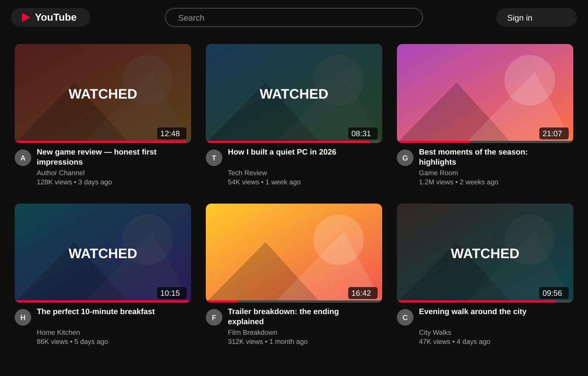

# YouTube Watched Marker

**English** | [Русский](README.ru.md)

A userscript for YouTube that marks watched videos right in the feed. The thumbnail of a watched video is dimmed and overlaid with a watched label in the YouTube interface language — **«ПРОСМОТРЕНО»** in Russian, **"WATCHED"** in English, **"GESEHEN"** in German and so on — always on a single line, with its size automatically adapting to the thumbnail size, so it looks right on the home page, in search results, in subscriptions and in the sidebar alike.

This is a fork of **YouTube Flag Watched** from the [mchangrh/uscripts](https://github.com/mchangrh/uscripts) repository (file `yt/yt-watched.user.js`), originally by michael (mchang.name).

- **Fork author:** EX1lIUM
- **Co-author:** Muse — model Muse Spark 1.3 (Meta)
- **Version:** 1.0.0 — November 16, 2026

## How it works

YouTube itself stores the watch progress in the thumbnail markup as an inline style like `style="width: 93%;"` on the progress element. The script makes no network requests and keeps no data of its own — it only injects CSS that finds thumbnails with progress from 90% up to 100%, dims them (`opacity: 0.35`) and overlays the label. This is why you need to be signed in to YouTube with watch history enabled: without it, there is no progress in the markup.

Both YouTube markups are covered: the classic `ytd-thumbnail` (the legacy `#progress` element and the current resume-playback progress class) and the new lockup UI (`yt-lockup-view-model`, where the bar is a `...BarSegment` element).

The label language is picked automatically from the YouTube interface language (the `<html lang="...">` attribute): Russian UI — «ПРОСМОТРЕНО», German — "GESEHEN", Japanese — «視聴済み», and so on. The script carries a translation for **every language in the YouTube language menu — all 83 entries**, including both written forms of Chinese and both scripts of Serbian; regional variants (English (UK), Español (Latinoamérica) and so on) share the translation of their base language. Only a language outside that menu would fall back to English "WATCHED". If you switch the YouTube language in settings, the label follows on the next page load.

## Installation

The script runs in a browser through a userscript manager extension. Pick one manager, install the script from the direct link below, and reload YouTube — updates will then arrive automatically from this repository.

### 1. Install a userscript manager

- **Tampermonkey** — [official website](https://www.tampermonkey.net/) · [Chrome Web Store](https://chromewebstore.google.com/detail/tampermonkey/dhdgffkkebhmkfjojejmpbldmpobfkfo) · [Firefox Add-ons](https://addons.mozilla.org/firefox/addon/tampermonkey/)
- **Violentmonkey** (open source) — [official website](https://violentmonkey.github.io/) · [Chrome Web Store](https://chromewebstore.google.com/detail/violentmonkey/jinjaccalgkegednnccohejagnlnfdag) · [Firefox Add-ons](https://addons.mozilla.org/firefox/addon/violentmonkey/)

### 2. Install the script

Open the direct link: **[yt-watched-marker.user.js](https://raw.githubusercontent.com/EX1lIUMRK/yt-watched-marker/main/yt-watched-marker.user.js)**. The userscript manager should intercept it and show an installation screen — press **Install** / **Confirm installation**.

If the browser simply downloads the file or shows its text instead, use the manual route: open [`yt-watched-marker.user.js`](https://github.com/EX1lIUMRK/yt-watched-marker/blob/main/yt-watched-marker.user.js) in this repository, copy the whole file, then in your manager choose **Add new script**, replace the template with the copied contents and save.

### 3. Reload YouTube

Open or reload any YouTube page. You need to be signed in and have watch history enabled — otherwise YouTube does not put watch progress into the thumbnails and there is nothing to mark. No further setup is needed.

### If the script does not run in Chrome / Chromium

Chrome requires an extra permission for userscript managers. Open `chrome://extensions`, find your manager, open **Details** and enable **Allow user scripts**, then reload YouTube. In Microsoft Edge the same toggle is on the extension details page under `edge://extensions`.

## No settings

There is nothing to configure. Everything is automatic, out of the box:

- a video counts as watched at **90%** or more;
- the label language follows the YouTube interface language;
- the label size adapts to the thumbnail size.

The script also has no external dependencies: it loads nothing from the network and uses only the `GM_addStyle` API of your userscript manager.

## Limitations

- Only videos for which YouTube has watch progress are marked (you are signed in and watch history is on).
- The script relies on the current YouTube markup (a progress element with a `width: N%` inline style, in the classic or the lockup variant). If YouTube changes the markup again, the selectors may stop matching until the script is updated.

## Differences from the original

- The label is shown in the YouTube UI language (a translation for every language in the YouTube language menu, English fallback) instead of a hard-coded "WATCHED", always on one line.
- Adaptive label size (container query units, `cqw`) instead of a fixed `1.4rem`.
- A video counts as watched at 90% or more instead of exactly 100%.
- No settings and no external dependencies: everything works automatically out of the box.
