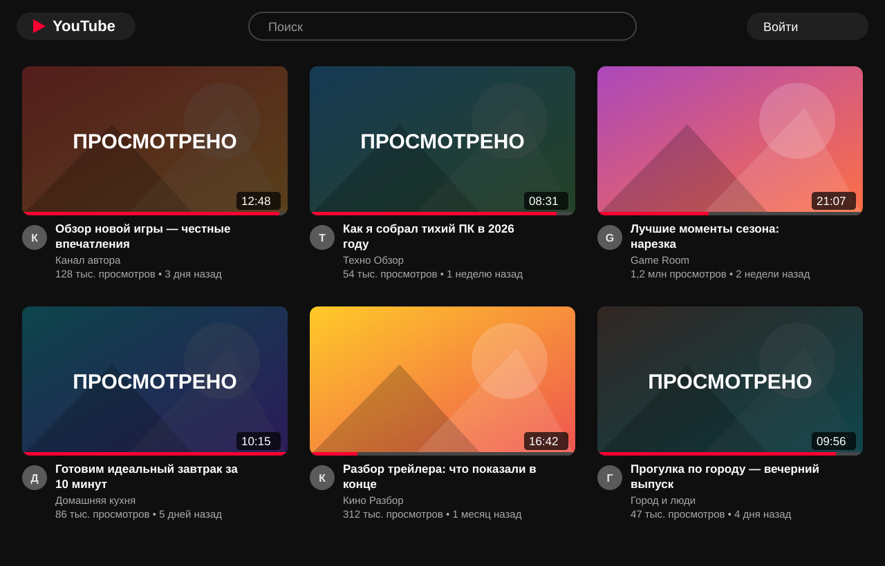

# YouTube Watched Marker

[English](README.md) | **Русский**

Юзерскрипт для YouTube: помечает досмотренные видео прямо в ленте. Миниатюра просмотренного видео затемняется, а поверх неё появляется надпись на языке интерфейса YouTube — **«ПРОСМОТРЕНО»** при русском, **«WATCHED»** при английском, **«GESEHEN»** при немецком и так далее — всегда в одну строку, а её размер автоматически подстраивается под размер миниатюры, поэтому одинаково выглядит на главной, в поиске, в подписках и в боковой панели.

Это форк скрипта **YouTube Flag Watched** из репозитория [mchangrh/uscripts](https://github.com/mchangrh/uscripts) (файл `yt/yt-watched.user.js`), автор оригинала — michael (mchang.name).

- **Автор форка:** EX1lIUM
- **Соавтор:** Muse — модель Muse Spark 1.3 (Meta)
- **Версия:** 1.0.0 — 16 ноября 2026

## Как это работает

Сам YouTube хранит прогресс просмотра в разметке миниатюры: инлайн-стиль вида `style="width: 93%;"` на элементе прогресса. Скрипт не делает запросов и не хранит своих данных — он только добавляет CSS, который находит миниатюры с прогрессом от 90% до 100%, затемняет их (`opacity: 0.35`) и накладывает надпись. Поэтому для работы нужны вход в аккаунт YouTube и включённая история просмотров — без неё прогресса в разметке нет.

Покрыты обе разметки YouTube: классическая `ytd-thumbnail` (устаревший элемент `#progress` и текущий класс прогресса resume-playback) и новый интерфейс lockup (`yt-lockup-view-model`, где полоска — элемент `...BarSegment`).

Язык надписи выбирается автоматически по языку интерфейса YouTube (атрибут `<html lang="...">`): русский интерфейс — «ПРОСМОТРЕНО», немецкий — «GESEHEN», японский — «視聴済み» и так далее. В скрипт встроен перевод для **каждого языка из меню языков YouTube — все 83 пункта**, включая обе письменные формы китайского и обе письменности сербского; региональные варианты (English (UK), Español (Latinoamérica) и так далее) используют перевод базового языка. Английская «WATCHED» осталась только запасным вариантом для языка вне этого меню. Если переключите язык YouTube в настройках, надпись подстроится при следующей загрузке страницы.

## Установка

Скрипт работает в браузере через расширение — менеджер юзерскриптов. Выберите один менеджер, установите скрипт по прямой ссылке ниже и обновите YouTube — дальше обновления будут приходить автоматически из этого репозитория.

### 1. Установите менеджер юзерскриптов

- **Tampermonkey** — [официальный сайт](https://www.tampermonkey.net/) · [Chrome Web Store](https://chromewebstore.google.com/detail/tampermonkey/dhdgffkkebhmkfjojejmpbldmpobfkfo) · [Firefox Add-ons](https://addons.mozilla.org/firefox/addon/tampermonkey/)
- **Violentmonkey** (открытый исходный код) — [официальный сайт](https://violentmonkey.github.io/) · [Chrome Web Store](https://chromewebstore.google.com/detail/violentmonkey/jinjaccalgkegednnccohejagnlnfdag) · [Firefox Add-ons](https://addons.mozilla.org/firefox/addon/violentmonkey/)

### 2. Установите скрипт

Откройте прямую ссылку: **[yt-watched-marker.user.js](https://raw.githubusercontent.com/EX1lIUMRK/yt-watched-marker/main/yt-watched-marker.user.js)**. Менеджер юзерскриптов должен перехватить её и показать экран установки — нажмите **«Установить»** / **«Подтвердить установку»**.

Если браузер вместо этого просто скачал файл или показал его текст, есть ручной путь: откройте [`yt-watched-marker.user.js`](https://github.com/EX1lIUMRK/yt-watched-marker/blob/main/yt-watched-marker.user.js) в этом репозитории, скопируйте файл целиком, затем в менеджере выберите **«Добавить новый скрипт»**, замените шаблон скопированным содержимым и сохраните.

### 3. Обновите YouTube

Откройте или обновите любую страницу YouTube. Нужны вход в аккаунт и включённая история просмотров — иначе YouTube не добавляет прогресс просмотра в миниатюры и помечать нечего. Больше ничего настраивать не нужно.

### Если скрипт не запускается в Chrome / Chromium

Chrome требует для менеджеров юзерскриптов отдельное разрешение. Откройте `chrome://extensions`, найдите свой менеджер, зайдите в **«Сведения»** и включите **«Разрешить пользовательские скрипты»** (Allow user scripts), затем обновите YouTube. В Microsoft Edge тот же переключатель находится на странице сведений о расширении в `edge://extensions`.

## Настроек нет

Настраивать нечего. Всё происходит автоматически, из коробки:

- видео считается просмотренным при **90%** и больше;
- язык надписи следует за языком интерфейса YouTube;
- размер надписи подстраивается под размер миниатюры.

Внешних зависимостей у скрипта тоже нет: он ничего не загружает из сети и использует только API `GM_addStyle` вашего менеджера юзерскриптов.

## Ограничения

- Помечаются только видео, по которым у YouTube есть прогресс просмотра (вы вошли в аккаунт и история просмотров включена).
- Скрипт опирается на текущую разметку YouTube (элемент прогресса с инлайн-стилем `width: N%`, в классическом или lockup-варианте). Если YouTube снова изменит разметку, селекторы могут перестать срабатывать до обновления скрипта.

## Отличия от оригинала

- Надпись показывается на языке интерфейса YouTube (перевод для каждого языка из меню языков YouTube, запасной — английский) вместо жёстко заданной «WATCHED», всегда в одну строку.
- Размер надписи адаптивный (container query units, `cqw`) вместо фиксированного `1.4rem`.
- Видео считается просмотренным при 90% и больше вместо ровно 100%.
- Никаких настроек и внешних зависимостей: всё работает автоматически, из коробки.
